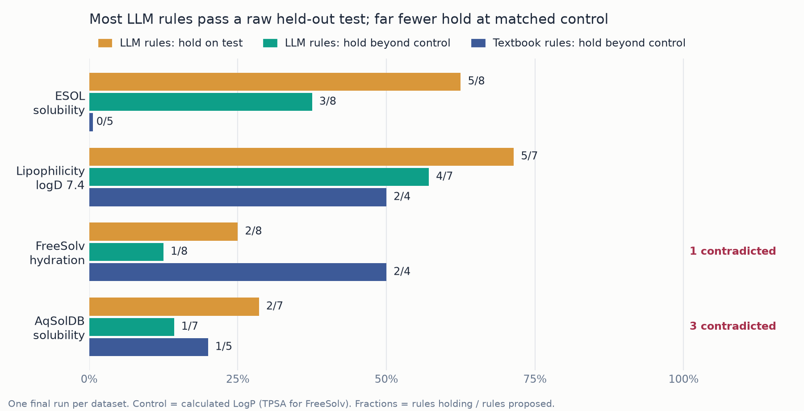

<p align="center"></p>

<h1 align="center">Litmus</h1>

<p align="center"><strong>A litmus test for AI explanations of molecular models.</strong><br>
<em>Do an LLM's chemistry claims survive contact with held-out data?</em></p>

An LLM reads counterfactual explanations of a property model and writes
confident chemistry rules (*"carboxylic acids lower logD"*). This pipeline
turns each rule into an executable test, checks it on measurements the LLM
never saw, and asks the published literature for a second opinion.

**Litmus is a pipeline, not a one-off study.** It works on any molecular
property with a measured numeric value: give it a CSV of SMILES and targets
plus one config file, and every rule the LLM proposes gets the same tests.
The results below come from test runs on the datasets provided for the
hackathon: ESOL, Lipophilicity and FreeSolv from
[awesome-matchem-datasets](https://github.com/blaiszik/awesome-matchem-datasets),
plus a larger solubility set, AqSolDB.

<p align="center">
  
</p>

**Where this sits.** HypoBench (arXiv 2504.11524) benchmarks LLM hypothesis
generation in general domains; [XpertAI](https://doi.org/10.1038/s42004-024-01393-y)
generates chemistry explanations validated by expert judgement. This project
combines the two: counterfactual-derived chemistry hypotheses, falsified on
held-out measurements and cross-checked against literature.

---

## Results: test runs on the hackathon datasets

Each rule gets two tests on the held-out split. The **direct** test asks
whether molecules matching the rule really differ. The **beyond-control**
test compares molecules only with others that have a similar value of the
descriptor that already dominates the property (calculated LogP for
solubility and logD, polar surface area for hydration energy), and asks
whether the rule still holds. In total the LLM proposed 30 rules across the
four datasets.

<p align="center">
  
</p>

| Dataset | Test n | LLM: holds | LLM: holds beyond control | LLM: contradicted | Textbook: beyond control |
|---|---|---|---|---|---|
| ESOL | 169 | 5/8 | 3/8 | 0 | 0/5 |
| Lipophilicity (logD 7.4) | 630 | 5/7 | **4/7** | 0 | 2/4 |
| FreeSolv | 148 | 2/8 | 1/8 | 1 | 2/4 |
| AqSolDB | 1,497 | 2/7 | 1/7 | **3** | 1/5 |

*One final run per dataset. "Beyond control" = the effect survives at matched
calculated LogP (TPSA for FreeSolv). LLM output varies between runs (ESOL:
1/8, 0/8, 3/8 across development runs).*

- **Most claims pass a naive test; few say more than the obvious.** It depends
  on the property: logD has chemistry LogP misses (ionisation) and the LLM
  finds it; for solubility most rules restate lipophilicity. Textbook rules
  behave the same way.
- **Revision makes correct claims wrong.** Shown validation feedback, the LLM
  reversed *"primary amines → more soluble"* (correct) into *"→ less soluble,
  because H-bonds raise crystal lattice energy"*: test effect **+1.05 log
  units, p = 4×10⁻¹², n = 175** (AqSolDB). Three times on two datasets.
  Literature agrees with the data: *"hydrogen-bond propensity … always leads
  to an increase in solubility"* ([Abraham & Le 1999](https://pubmed.ncbi.nlm.nih.gov/10479348/)).
- **Literature and data catch different failures.** The blind judge rules on
  a claim's *mechanism*, the data on its *effect*: a claim with a plausible
  mechanism can pass the literature and fail on data, and vice versa
  (final runs: agree 20, disagree 3, no evidence 25; 166/169 quotes verified;
  articles retrieved with Bond Valency).
- **One surviving rule worth a chemist's look:** *"TPSA < 10 Ų → less
  soluble at matched LogP"* (ESOL, −2.17 within LogP bins, found in two runs).

Details: [`results/summary.md`](results/summary.md),
`results/<dataset>/literature/adjudication.md`, and every run's rules,
prompt and manifest under `results/<dataset>/<run>/`.

---

## Quick start

Needs Python 3.11+ and either `ANTHROPIC_API_KEY` or the
[Claude Code](https://docs.anthropic.com/claude-code) CLI logged in.

```bash
python -m venv .venv && source .venv/bin/activate
pip install -r requirements.txt

python run_pipeline.py --dataset configs/esol.json --skip-llm               # no LLM
python run_pipeline.py --dataset configs/esol.json --n-bases 20 --revise --run-name my-run
python -m src.summary                                                       # cross-dataset table
```

Literature stage: `python -m src.literature configs/<name>.json export|fetch|judge|table`
(retrieval runs in an interactive Claude Code session with the Valency
connector; see the module docstring).

## How it works

1. **Explain**: scaffold split 70/15/15, random forest on ECFP4,
   exmol counterfactuals for 20 training molecules.
2. **Propose**: an isolated LLM (no tools, no MCP, empty directory) writes up
   to 8 rules, each a sentence plus an RDKit descriptor threshold or SMARTS
   pattern and a direction.
3. **Falsify** (`src/rules.py`): on the test split, a raw Welch test and a
   within-control-bins permutation test, Benjamini–Hochberg, and the
   dataset's noise floor. Verdicts: `survives_beyond_control`,
   `control_only`, `untestable_beyond_control`, `fails`, `contradicted`,
   `insufficient_support`.
4. **Cross-check**: articles for each claim are retrieved with
   **Bond Valency** semantic search (top 5) → PubMed/chemRxiv abstracts →
   blind zero-tool judge whose quotes must appear verbatim.

**Kept honest by:** the test split never reaches an LLM (revision sees
validation only); noise floors, controls and textbook rules are committed in
each config before its first run; textbook rules go through the same harness.

## Datasets

| Config | Property | Molecules | Control | Pre-registered | Source |
|---|---|---|---|---|---|
| `esol` | aqueous solubility | 1,117 | MolLogP | no (development) | hackathon list |
| `lipophilicity` | logD at pH 7.4 | 4,200 | MolLogP | yes | hackathon list |
| `freesolv` | hydration free energy | 624 | TPSA | yes | hackathon list |
| `aqsoldb` | aqueous solubility | 9,980 | MolLogP | yes | Harvard Dataverse |

"Hackathon list" = [awesome-matchem-datasets](https://github.com/blaiszik/awesome-matchem-datasets).
AqSolDB is not on that list; it was added as a larger, independent
solubility set.

### Running it on your own dataset

Nothing in the code is specific to solubility. Everything about a property
lives in one JSON file in `configs/` (see `configs/freesolv.json` for a
complete example):

| Field | What it sets |
|---|---|
| `source` | download URL, citation and `read_csv` options |
| `smiles_col`, `target_col` | which columns hold the structure and the measured value |
| `property`, `units`, `higher_means` | wording used in the LLM prompts and reports |
| `noise_floor`, `noise_floor_source` | smallest effect that counts as a finding, with its citation |
| `cf_threshold` | how big a prediction change makes a counterfactual (5/3 × noise floor) |
| `control` | the descriptor that dominates the property (any RDKit descriptor), with a rationale and reference |
| `baseline` | textbook rules run through the same tests, for comparison |

Then:

1. Copy a config, fill in the fields, and **commit it before the first
   run** (that is what makes it pre-registered).
2. `python run_pipeline.py --dataset configs/<name>.json --n-bases 20 --revise --run-name <run>`
3. Optionally run the literature stage (see Quick start).

**What it supports:** SMILES input with a continuous numeric target. Rule
conditions are RDKit descriptor thresholds or SMARTS patterns. Choosing the
control descriptor for a new property takes chemistry judgement, once per
property. So far it has been run only on the four solvation-related
properties above; bioactivity, toxicity or materials properties are untested.

## Limitations

Continuous targets only. The predictor is deliberately simple; rules are
tested against measurements, not predictions. Public datasets may be in the
LLM's pretraining data. One run per dataset, about eight rules each, and LLM
output varies between runs. Tested so far only on solvation-related
properties.

## Presentation materials

- `docs/workflow.png`: illustrated pipeline figure (`docs/pipeline.png` is a plain version)
- `docs/results.png`: the results chart above
- `docs/script.pdf`: script for the hackathon video
- `docs/thumbnail.png`: video thumbnail

## License

[MIT](LICENSE).

## Acknowledgements

Bond Valency for literature retrieval in the cross-check; exmol/MMACE
(Wellawatte, Seshadri & White); datasets by Delaney (ESOL),
AstraZeneca via ChEMBL/MoleculeNet (Lipophilicity), Mobley & Guthrie
(FreeSolv), Sorkun, Khetan & Er (AqSolDB); sources for noise floors and
textbook rules are cited in the configs.
