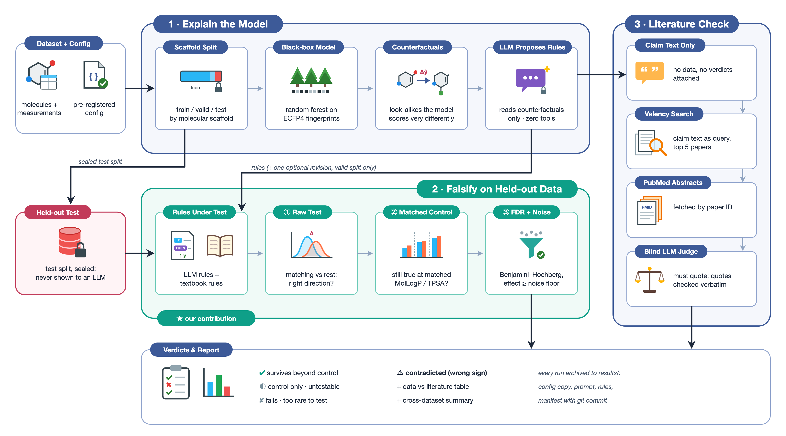

<h1 align="center">Falsifying Counterfactuals</h1>

<p align="center"><em>Do an LLM's explanations of a molecular property model survive contact with held-out data?</em></p>

An LLM reads counterfactual explanations of a property model and writes
confident chemistry rules (*"carboxylic acids lower logD"*). This pipeline
turns each rule into an executable test, checks it on measurements the LLM
never saw, and asks the published literature for a second opinion.

<p align="center">
  
</p>

**Where this sits.** HypoBench (arXiv 2504.11524) benchmarks LLM hypothesis
generation in general domains; [XpertAI](https://doi.org/10.1038/s42004-024-01393-y)
generates chemistry explanations validated by expert judgement. This project
combines the two: counterfactual-derived chemistry hypotheses, falsified on
held-out measurements and cross-checked against literature.

---

## Results

| Dataset | Test n | LLM: holds | LLM: holds beyond control | LLM: contradicted | Textbook: beyond control |
|---|---|---|---|---|---|
| ESOL | 169 | 5/8 | 3/8 | 0 | 0/5 |
| Lipophilicity (logD 7.4) | 630 | 5/7 | **4/7** | 0 | 2/4 |
| FreeSolv | 148 | 2/8 | 1/8 | 1 | 2/4 |
| AqSolDB | 1,497 | 2/7 | 1/7 | **3** | 1/5 |

*One final run per dataset. "Beyond control" = the effect survives at matched
calculated LogP (TPSA for FreeSolv). LLM output varies between runs (ESOL:
1/8, 0/8, 3/8 across development runs).*

- **Most claims pass a naive test; few say more than the obvious.** It depends
  on the property: logD has chemistry LogP misses (ionisation) and the LLM
  finds it; for solubility most rules restate lipophilicity. Textbook rules
  behave the same way.
- **Revision makes correct claims wrong.** Shown validation feedback, the LLM
  reversed *"primary amines → more soluble"* (correct) into *"→ less soluble,
  because H-bonds raise crystal lattice energy"*: test effect **+1.05 log
  units, p = 4×10⁻¹², n = 175** (AqSolDB). Three times on two datasets.
  Literature agrees with the data: *"hydrogen-bond propensity … always leads
  to an increase in solubility"* ([Abraham & Le 1999](https://pubmed.ncbi.nlm.nih.gov/10479348/)).
- **Literature and data catch different failures.** The blind judge rules on
  a claim's *mechanism*, the data on its *effect*: a claim with a plausible
  mechanism can pass the literature and fail on data, and vice versa
  (final runs: agree 20, disagree 3, no evidence 25; 166/169 quotes verified).
- **One surviving rule worth a chemist's look:** *"TPSA < 10 Ų → less
  soluble at matched LogP"* (ESOL, −2.17 within LogP bins, found in two runs).

Details: [`results/summary.md`](results/summary.md),
`results/<dataset>/literature/adjudication.md`, and every run's rules,
prompt and manifest under `results/<dataset>/<run>/`.

---

## Quick start

Needs Python 3.11+ and either `ANTHROPIC_API_KEY` or the
[Claude Code](https://docs.anthropic.com/claude-code) CLI logged in.

```bash
python -m venv .venv && source .venv/bin/activate
pip install -r requirements.txt

python run_pipeline.py --dataset configs/esol.json --skip-llm               # no LLM
python run_pipeline.py --dataset configs/esol.json --n-bases 20 --revise --run-name my-run
python -m src.summary                                                       # cross-dataset table
```

Literature stage: `python -m src.literature configs/<name>.json export|fetch|judge|table`
(retrieval runs in an interactive Claude Code session with the Valency
connector; see the module docstring).

## How it works

1. **Explain**: scaffold split 70/15/15, random forest on ECFP4,
   exmol counterfactuals for 20 training molecules.
2. **Propose**: an isolated LLM (no tools, no MCP, empty directory) writes up
   to 8 rules, each a sentence plus an RDKit descriptor threshold or SMARTS
   pattern and a direction.
3. **Falsify** (`src/rules.py`): on the test split, a raw Welch test and a
   within-control-bins permutation test, Benjamini–Hochberg, and the
   dataset's noise floor. Verdicts: `survives_beyond_control`,
   `control_only`, `untestable_beyond_control`, `fails`, `contradicted`,
   `insufficient_support`.
4. **Cross-check**: Valency search → PubMed/chemRxiv abstracts → blind
   zero-tool judge whose quotes must appear verbatim.

**Kept honest by:** the test split never reaches an LLM (revision sees
validation only); noise floors, controls and textbook rules are committed in
each config before its first run; textbook rules go through the same harness.

## Datasets

| Config | Property | Molecules | Control | Pre-registered |
|---|---|---|---|---|
| `esol` | aqueous solubility | 1,117 | MolLogP | no (development) |
| `lipophilicity` | logD at pH 7.4 | 4,200 | MolLogP | yes |
| `freesolv` | hydration free energy | 624 | TPSA | yes |
| `aqsoldb` | aqueous solubility | 9,980 | MolLogP | yes |

**Add your own:** copy a config, set source, columns, noise floor (with a
source), control and textbook rules, commit it, then run.

## Limitations

Continuous targets only. The predictor is deliberately simple; rules are
tested against measurements, not predictions. Public datasets may be in the
LLM's pretraining data. One run per dataset.

## License

[MIT](LICENSE).

## Acknowledgements

exmol/MMACE (Wellawatte, Seshadri & White); datasets by Delaney (ESOL),
AstraZeneca via ChEMBL/MoleculeNet (Lipophilicity), Mobley & Guthrie
(FreeSolv), Sorkun, Khetan & Er (AqSolDB); sources for noise floors and
textbook rules are cited in the configs.
